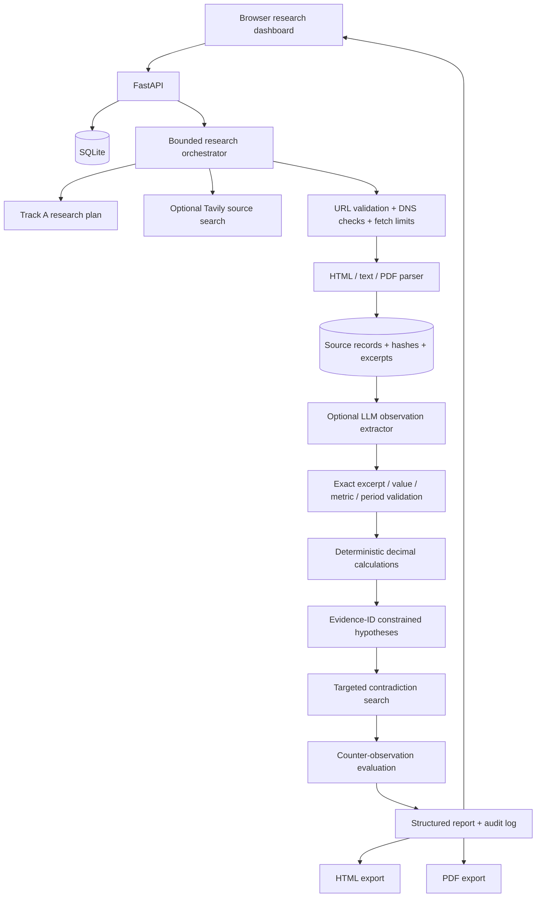

# Architecture

The current version is a modular monolith. Research runs are persisted, but processing still occurs in the API request lifecycle; a durable background queue is not implemented. Search and LLM integrations are optional and configured server-side. Without keys, the app remains runnable and abstains rather than fabricating a discovery.

## Evidence flow
1. Search results and manually supplied public URLs become candidate source URLs.
2. URL safety checks and bounded retrieval run before parsing.
3. Source metadata, content hash, full extracted text, excerpt and fetch errors are persisted.
4. The optional LLM extractor must return a passage that is an exact substring of source text. Code checks source ID/URL, raw value, metric label and period against that passage.
5. Only accepted observations enter calculation/hypothesis stages. Calculations are deterministic and period/reporting-basis aware.
6. Hypotheses must cite observation/calculation IDs. A skeptic query is run when search is configured. Candidate pages are fetched and their observations are separately validated before they may be marked as opposing observations.
7. Evidence scoring remains conservative. Search result presence alone is not corroboration; Strong is not assigned while the counter-evidence path is not fully resolved.

## Security boundary
The fetcher rejects unsafe URL schemes, embedded credentials, localhost/private/reserved targets and unsafe redirects, and enforces timeouts and response-size limits. DNS checks alone do not fully prevent DNS rebinding because the HTTP client may resolve the hostname separately. Production deployment must also enforce network-level egress restrictions.
